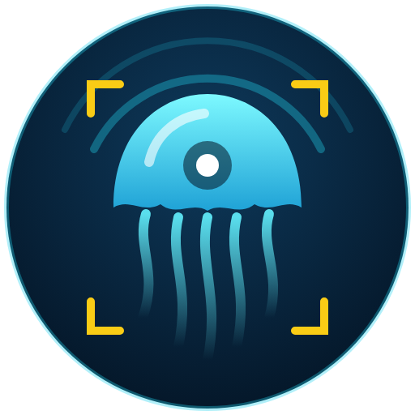
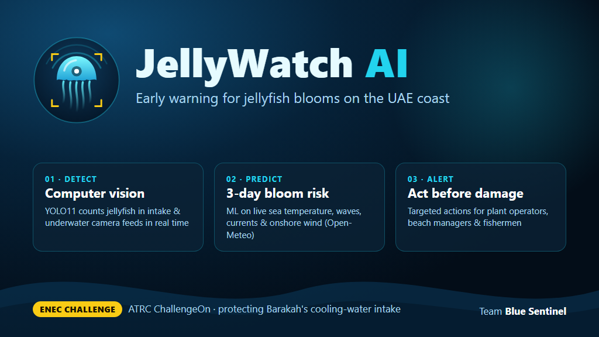
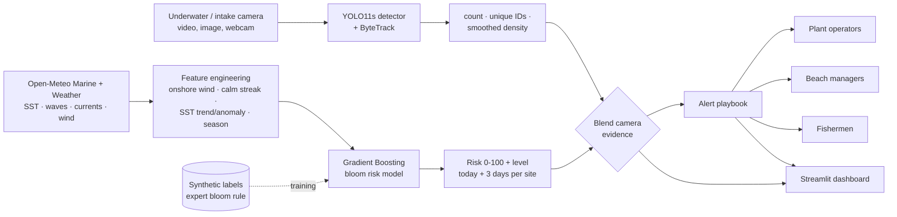

<p align="center"></p>

# JellyWatch AI

**Detect · Predict · Alert** — early warning for jellyfish blooms on the UAE coast.
ATRC ChallengeOn · ENEC challenge · Team **Blue Sentinel** (Yosef)

> *How might we advance the sustainable management of seasonal jellyfish blooms in coastal environments?*



## 1. Problem
Jellyfish blooms clog the seawater cooling intakes of coastal power plants (incl. nuclear plants such as
Barakah), forcing power reductions or shutdowns. They also close beaches and damage fishing nets.
Operators usually learn about a bloom when the screens are already blocked.

## 2. Solution
| Layer | What it does | Tech |
|---|---|---|
| **Detect** | Counts jellyfish on underwater / intake cameras; tracks individuals; smoothed density per frame | YOLO11s fine-tuned + ByteTrack, OpenCV |
| **Predict** | Bloom risk 0–100 + level (Low/Medium/High/Critical) for today + 3 days at each site, with human-readable drivers | Gradient Boosting (scikit-learn) on Open-Meteo marine + weather data |
| **Alert** | Who must act and how: plant operators, beach managers, fishermen. Camera evidence instantly raises risk | Rule playbook, optional Telegram |
| **Dashboard** | Map, live detection, forecast, alerts feed | Streamlit, folium, plotly |

### Architecture


## 3. Results
| Metric | Value |
|---|---|
| Detector — test mAP@50 / mAP@50-95 | see `models/detector_metrics.json` (filled by `train.py`) |
| Risk model — ROC-AUC on last 12 months (vs **synthetic** labels) | 0.80 |
| Weather/ocean history used | 2022-01-01 → today, 3 sites, ~5,200 site-days (REAL) |

## 4. What is real vs synthetic
| Component | Status |
|---|---|
| Sea-surface temp, waves, currents, wind (history + forecast) | **REAL** — Open-Meteo Marine / Archive / Forecast APIs |
| Detector training images | **REAL** — Roboflow *Aquarium* + Aalborg University *Brackish* (fixed underwater camera), both CC BY 4.0, + Google *Open Images V7* “Jellyfish” (boxes CC BY 4.0, images CC BY 2.0) |
| Bloom labels for the risk model | **SYNTHETIC** — transparent expert rule (warm water, calm sea, onshore wind, weak currents, season) + noise, see [`src/prediction/features.py`](src/prediction/features.py). No public daily Gulf bloom records exist. |
| Risk-model ROC-AUC | Measures how well the model reproduces the synthetic rule from real weather — **not** real-world skill |
| Demo videos | Wikimedia Commons moon-jellyfish footage (Netherlands, CC BY-SA) — stand-in for an intake camera |
| Site coordinates | **Approximate** |

## 5. How to run
```bash
# 1. environment (Python 3.11/3.12)
python -m venv .venv
.venv\Scripts\activate            # Windows   |  source .venv/bin/activate  (macOS/Linux)
pip install -r requirements.txt   # CPU build of PyTorch (same as the cloud deployment)
# optional, NVIDIA GPU for faster training:
pip install --force-reinstall torch==2.6.0 torchvision==0.21.0 --index-url https://download.pytorch.org/whl/cu118

# 2. data (no accounts / API keys needed)
python src/detection/prepare_dataset.py     # jellyfish dataset -> data/images/jellyfish
python src/detection/make_demo_videos.py    # demo clips -> data/videos/
python src/prediction/fetch_data.py         # real ocean + weather -> data/environment/

# 3. models
python src/detection/train.py               # YOLO11s, ~25 min on RTX 2060 -> models/best.pt
python src/prediction/risk_model.py --train # risk model + feature importance -> models/risk_model.pkl

# 4. use
python src/detection/detect.py --source data/videos/demo_bloom.mp4   # annotated mp4 + CSV in outputs/
python src/detection/detect.py --source 0 --show                     # webcam
python src/prediction/risk_model.py --predict                        # 3-day risk per site
python src/alerts/alerts.py --density 7.5                            # alerts (+ live camera density)
streamlit run app/dashboard.py                                       # the dashboard
```
Optional Telegram alerts: set `TELEGRAM_BOT_TOKEN` and `TELEGRAM_CHAT_ID`, then `python src/alerts/alerts.py --telegram`.

## 6. Project structure
```
jellywatch/
├── app/dashboard.py              Streamlit dashboard (map · live detection · forecast · alerts)
├── src/config.py                 sites, thresholds, paths
├── src/detection/                prepare_dataset · make_demo_videos · train · detect
├── src/prediction/               fetch_data · features (+ synthetic labels) · risk_model
├── src/alerts/alerts.py          alert playbook + Telegram
├── data/{images,videos,environment}
├── models/                       best.pt · risk_model.pkl · metrics
├── assets/                       logo, cover image
└── SUBMISSION.md                 short descriptions + demo script
```

## 7. Next steps
1. **Real camera at the Barakah intake** (and at the travelling screens) streaming into the detector.
2. **Real labels**: ENEC intake-screen cleaning logs + EAD jellyfish surveys replace the synthetic rule — same pipeline.
3. **Sonar / drone integration** for detection beyond camera range and in turbid water; satellite chlorophyll as a feature.
4. **Sustainable management — jellyfish as a resource**: early warning lets crews collect jellyfish offshore *before*
   they reach the intake and valorise the biomass (collagen, fertiliser, animal feed, food) instead of landfilling it.
5. Mobile push / SMS alerts for fishermen in Arabic & English; API for plant SCADA.

## Credits & licences
Aquarium dataset — Roboflow (CC BY 4.0). Brackish dataset — Pedersen et al., Aalborg University, CVPR-W 2019 (CC BY 4.0).
Open Images V7 — Google (annotations CC BY 4.0, images CC BY 2.0).
Demo footage — Wikimedia Commons (CC BY-SA). Weather & marine data — Open-Meteo (CC BY 4.0). Basemap — Esri.
Prototype for a hackathon — not for operational use.
